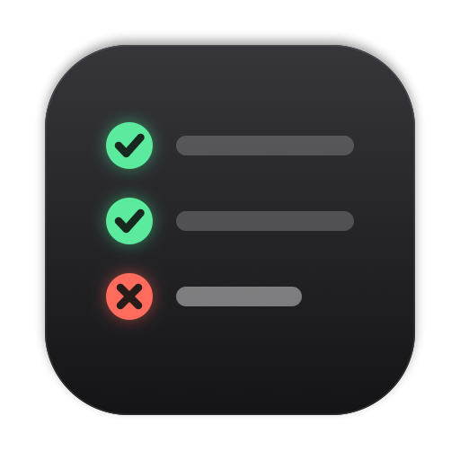
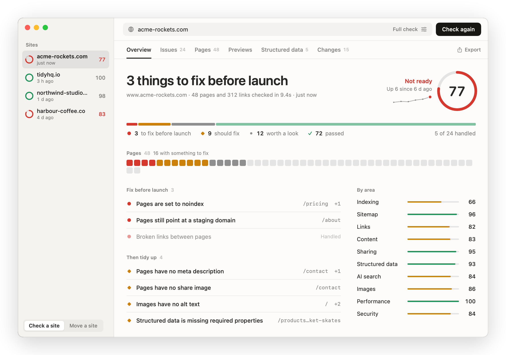
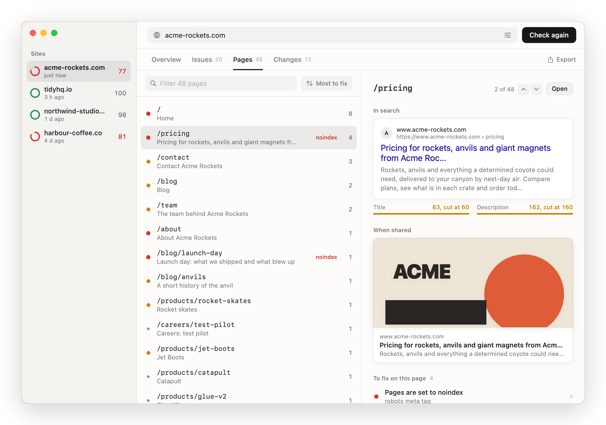
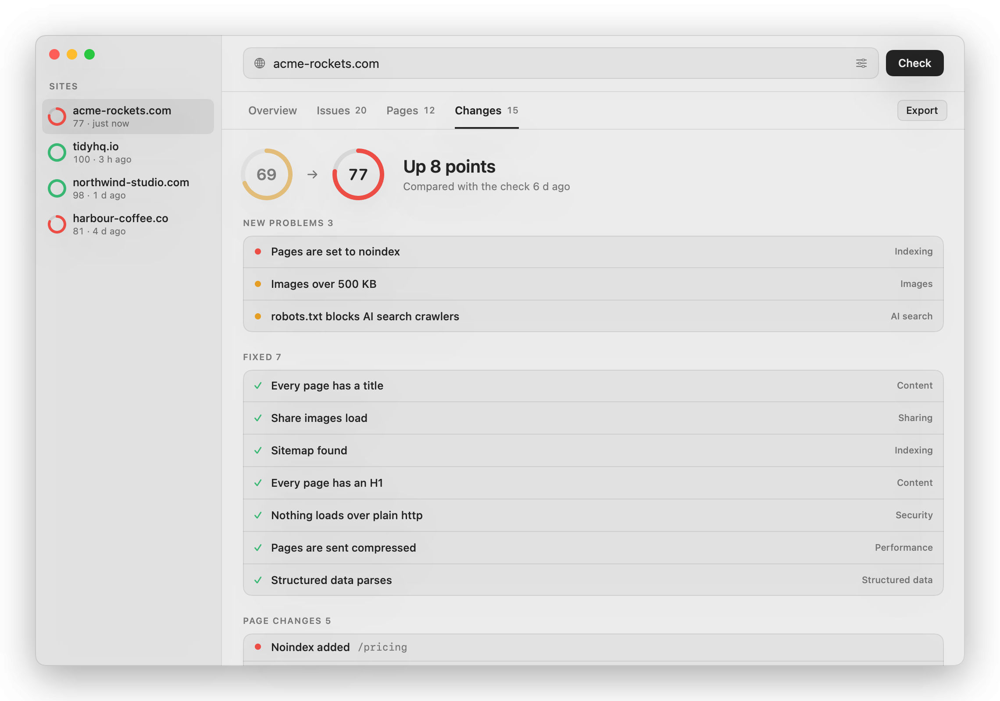
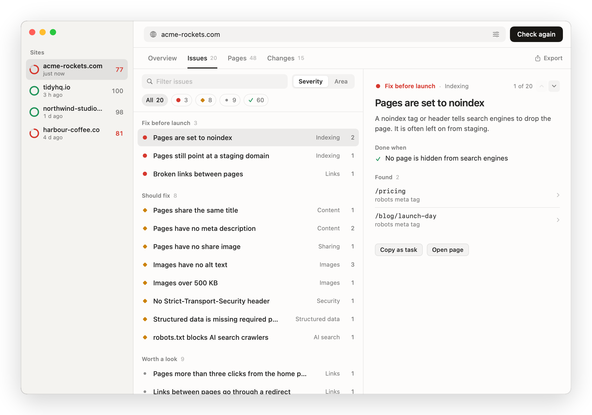

<p align="center">
  
</p>

<h1 align="center">Launchcheck</h1>

<p align="center">
  Check a site before it goes live.<br>
  Type an address. Get the list of things that would quietly cost the launch its search traffic.
</p>

<p align="center">
  <a href="https://github.com/BRIJRAJ-02/launchcheck/actions/workflows/ci.yml"></a>
  
  
  
</p>

<p align="center">
  <a href="https://brijraj-02.github.io/launchcheck/">Website</a> · <a href="https://github.com/BRIJRAJ-02/launchcheck/releases/latest">Download</a>
</p>

<p align="center">
  <picture>
    <source media="(prefers-color-scheme: dark)" srcset="docs/overview-dark.png">
    
  </picture>
</p>

## What it does

Most launch mistakes are not hard to fix. They are hard to notice: a noindex carried over from staging, a canonical still pointing at `something.webflow.io`, a share image that 404s, a robots.txt that shuts out the AI search engines. Launchcheck reads every page in the sitemap and runs 84 checks against it.

- **One line, then a score.** The verdict says whether the site can launch. The score says how far it is from tidy, broken down into ten areas.
- **The whole site at a glance.** One square per page, colored by the worst thing found on it. Click one to open that page.
- **Sorted by what matters.** Fix before launch, should fix, worth a look. Every check says why it matters, when it counts as done, and where it was found, and copies out as a checklist for a ticket.
- **Staging leftovers.** Noindex tags and headers, canonicals, share images and links that still point at a staging domain, and sitemaps generated on one.
- **Every link and image.** Broken links, broken and overweight images, redirect chains, temporary redirects, pages nothing links to, pages buried more than three clicks deep.
- **The head of every page.** Titles, descriptions, canonicals, headings, share tags, alt text, repeated tags.
- **Structured data.** JSON-LD that does not parse, is missing required properties, still has template placeholders, or uses a type that no longer earns a rich result.
- **AI search.** Whether the crawlers behind ChatGPT, Claude and Perplexity are allowed in, whether pages have content without JavaScript, and whether there is an llms.txt.
- **International.** Hreflang codes that do not exist, sets that leave themselves out, links that are not returned.
- **The domain.** http to https, www and non-www, security headers, compression, whether a missing page really returns a 404.
- **Works on any site.** Webflow, Framer, WordPress, hand-written. No sitemap? It follows links from the home page instead.

### Every page, the way it will be seen

<p align="center">
  <picture>
    <source media="(prefers-color-scheme: dark)" srcset="docs/pages-dark.png">
    
  </picture>
</p>

Pick a page to see it as a search result, with the title and description cut where a search engine would cut them, and as a link card in a chat or a feed. Below that: word count, response time, how many clicks it is from the home page, what links to it, and what is wrong with it.

### What changed since last time

<p align="center">
  <picture>
    <source media="(prefers-color-scheme: dark)" srcset="docs/changes-dark.png">
    
  </picture>
</p>

Each check of a site is kept. The next one is compared with it: what was fixed, what is new, and which pages changed their title, canonical, H1 or structured data, lost their share tags, or picked up a noindex. Run it before and after a deploy to see exactly what the deploy did.

<p align="center">
  <picture>
    <source media="(prefers-color-scheme: dark)" srcset="docs/issues-dark.png">
    
  </picture>
</p>

## Install

### Download

Get `Launchcheck-x.y.z.dmg` from the [latest release](https://github.com/BRIJRAJ-02/launchcheck/releases/latest), open it and drag Launchcheck to Applications. It runs on Apple Silicon and Intel, macOS 14 or later.

The app is not notarized, so macOS blocks the first launch. Either allow it under System Settings → Privacy & Security → Open Anyway, or run:

```bash
xattr -dr com.apple.quarantine /Applications/Launchcheck.app
```

### Build from source

Requires Xcode 16 or later (for the Swift toolchain).

```bash
git clone https://github.com/BRIJRAJ-02/launchcheck.git
cd launchcheck
./scripts/build-app.sh --install   # builds, copies Launchcheck.app to /Applications, links the CLI, launches it
```

## Using it

Type a site and press Return. Sites you have checked stay in the sidebar with their last score; click one to reopen its report without checking again. Point at a site and press the × to delete it, or use the menu beside “Sites” to delete them all. The Changes tab lists the checks kept for a site: open an older one, or delete any of them. The slider icon in the address bar sets how many pages to read (50, 200 or 1,000), whether links to other sites are followed, and whether images are weighed.

In Issues, the counts above the list are filters: everything, each level, or what passed. In Pages, the sort button orders the list by most to fix, slowest, fewest words, most clicks from home or address, and each row shows the figure it is sorted by. Both inspectors say where you are in the list (“2 of 48”) and step either way.

| Shortcut | Does |
|---|---|
| Return | Check the site |
| ↑ and ↓ | Move through the issues or the pages |
| Esc | Stop |
| ⌘R | Check again |
| ⌘1 to ⌘4 | Overview, Issues, Pages, Changes |
| ⇧⌘C | Copy the report as Markdown |
| ⌘S | Save the report as Markdown |

### Command line

The same engine, for a terminal or a CI job. It exits with 1 when something must be fixed before launch.

```bash
launchcheck example.com
launchcheck example.com --max-pages 1000 --no-external
launchcheck example.com --markdown > report.md
launchcheck example.com --json > before.json
launchcheck example.com --baseline before.json   # after the deploy: what changed
```

```
https://www.example.com/
2 things to fix before launch
Score 77 of 100 (Not ready) · 48 pages and 312 links checked in 9.4s

  Indexing         ██████████████░░░░░░ 71
  Links            ████████████████░░░░ 82
  Content          ████████████████░░░░ 83

FIX BEFORE LAUNCH

  ✗ Pages are set to noindex (2)
    A noindex tag or header tells search engines to drop the page. It is often left on from staging.
    - /pricing  robots meta tag
    - /blog/launch-day  robots meta tag
```

## What it checks

| Area | Fix before launch | Should fix | Worth a look |
|---|---|---|---|
| **Indexing** | robots.txt blocking everything or erroring · noindex pages · sitemap entries that do not load, sit on another domain or exceed 50,000 per file · staging leftovers · canonical on another domain | no sitemap · sitemap entries that redirect, are blocked or are not canonical · pages empty without JavaScript · no canonical · page-level nofollow · www and non-www both live · soft 404s | no robots.txt · sitemap not named in robots.txt · identical sitemap dates · noindex pages in the sitemap · linked pages missing from the sitemap · untidy addresses · canonical pointing elsewhere |
| **Links** | broken links between pages | pages nothing links to · meta refresh redirects · redirect chains · links with no text · broken links to other sites | pages more than three clicks deep · links through a redirect · temporary redirects · “click here” links |
| **Content** | missing titles | repeated titles, descriptions or head tags · missing description, H1, charset or viewport · placeholder text | title and description length · several H1s · skipped heading levels · pages under 200 words · no doctype, language or favicon |
| **Sharing** | share images that do not load | no share image | missing share text or Twitter card · og:url differing from the canonical |
| **Structured data** | | JSON-LD that does not parse · missing required properties · template placeholders | no structured data · retired types |
| **AI search** | | robots.txt blocking AI search crawlers · malformed llms.txt | no llms.txt |
| **Images** | images that do not load | missing alt text · images over 500 KB | images over 200 KB · no width and height · empty-calorie alt text · first image lazy-loaded |
| **Performance** | | pages over 2 MB of HTML · no compression | slow first byte · render-blocking scripts |
| **Security** | | files over plain http · http not redirecting · no HSTS | missing security headers · links to http addresses |
| **International** | | invalid hreflang codes · sets missing the page itself · links not returned | no x-default |

Some judgement calls, so the report stays trustworthy:

- **A site with anything in the first column is never called good**, whatever its score. The grade reads “Not ready”.
- **A problem on one page costs less than the same problem on every page.** Site-wide problems count in full.
- **AI crawlers that only gather training data are never flagged.** Blocking them is a business choice. Only the crawlers that fetch pages to answer a question and cite the source are checked: OAI-SearchBot, Claude-SearchBot and PerplexityBot.
- **Links to other sites** are only called broken when the page is plainly gone (404, 410, or a domain that does not exist). Many sites turn robots away with a 403, and that is not your broken link.
- **A link to a `webflow.io` address** only counts as a staging leftover on a site built with Webflow. Elsewhere it is more likely a deliberate link to someone's work.
- **An empty `alt=""`** is correct for a decorative image and passes. Only a missing attribute is flagged.
- **Checks that do not apply are left out, not passed.** A site in one language has no International score at all.
- **Response time is measured from your Mac**, once per page. It is a hint, not a lab result.

What it deliberately does not do: anything that needs a paid data source, a Google account or a judgement call a script cannot make. No keyword research, backlink counts, Core Web Vitals field data or content quality scoring.

## Design notes

- **One line first.** The verdict is the largest thing on screen. The score comes second, and everything below is evidence.
- **Color means something.** Red, amber and green are only ever severity. The rest is warm monochrome with hairlines.
- **Open what is urgent.** The most serious issue is already selected and explained. Everything else is one arrow key away.
- **Shape as well as color.** A disc must be fixed, a diamond should be, a small dot is worth a look, so severity survives color blindness.
- **Boxes only for real objects.** Lists are hairlines on one surface. The only cards are the search result and the share card, because those are cards in real life.
- **Motion that answers.** One small scale of durations and one curve, after the tokens at [transitions.dev](https://transitions.dev). Buttons press, the underline and the pill slide, labels swap through a light blur, a fresh report rises into place once. Keyboard actions never animate, and Reduce Motion is respected.
- **Numbers that hold still.** Counts use tabular digits, so nothing jitters while a check runs.
- **Plain words.** No jargon where a sentence will do, and every check says why it matters.
- **Show, do not describe.** A title that is too long is shown cut off, the way a search result would cut it.

## How it is built

```
Sources/
  LaunchcheckCore/   UI-free engine: fetching, HTML scanning, robots.txt and sitemaps, the checks, scoring, comparison, report formats
  Launchcheck/       the SwiftUI app
  launchcheck-cli/   the command-line front end
Tests/               the scanner, robots.txt, sitemaps, structured data, hreflang, scoring, comparison, and whole audits of pretend sites
scripts/             build-app.sh bundles the app and the DMG; make-icon.swift draws the icon in code; build-site.sh rebuilds the web page
site/                the one-page website, static HTML with the check catalogue written into it
```

- **No dependencies.** Networking is URLSession, XML is Foundation's parser, and HTML is read by a small tolerant scanner written for this, since a checker has to cope with whatever markup it is given.
- **Redirects are followed by hand**, so each hop is known and a sitemap entry that redirects can be told from one that loads.
- **Polite by default.** Six requests at a time, HEAD before GET for links, and page bodies are capped at 3 MB.
- **Tested without the network.** The audits in the test suite run against an in-memory web.

Launchcheck reads pages the way a crawler does: it does not run JavaScript, so tags added by scripts after load are not seen. That is also how search engines first see the page.

### Credit

Many of the rules beyond the launch basics (structured data, AI crawlers, hreflang, image weight, security headers, and the idea of comparing a site against its last check) follow the checklists gathered in [claude-seo](https://github.com/AgricIDaniel/claude-seo) by AgriciDaniel, MIT licensed. Launchcheck implements the ones a crawler can decide on its own.

### Developing

```bash
swift build && swift test       # or open Package.swift in Xcode
./scripts/build-app.sh --open   # build and launch the app bundle
./scripts/build-app.sh --dmg    # universal build, packaged as build/Launchcheck-<version>.dmg
.build/debug/Launchcheck --snapshot docs   # re-render the README screenshots with a sample report
./scripts/build-site.sh         # rebuild site/index.html from its template and the current list of checks
launchcheck --checks            # every check as JSON
```

## License

[MIT](LICENSE)
